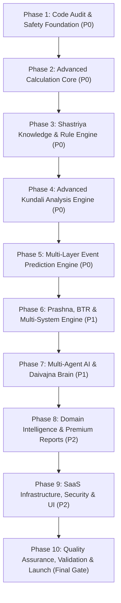

# Bharat Jyotish AI (JyotishOS) — सम्पूर्ण 10-Phase मास्टर सुधार एवं आधुनिकीकरण रोडमैप
**दस्तावेज़ संदर्भ:** Audit Report (5 नवम्बर 2026) एवं Master Modernization Architecture  
**सिस्टम स्थिति:** Production Shastriya Jyotish SaaS | **लक्ष्य:** World-Class Shastriya Accuracy & SaaS Scale

---

## कार्यकारी सारांश (Executive Summary)

यह दस्तावेज़ **Bharat Jyotish AI (JyotishOS)** को एक साधारण ज्योतिषीय एप्लिकेशन से विश्वस्तरीय **Enterprise Shastriya Jyotish Intelligence SaaS** में परिवर्तित करने का 10-चरणीय (10-Phase) मास्टर प्लान है। 

### गैर-समझौतावादी मूल नियम (Non-Negotiable Rules)
1. **एक समय में एक ही फेज (One Phase at a Time):** किसी भी फेज पर कार्य करने से पूर्व उसकी टास्क-सूची और टेस्ट प्लान का अनुमोदन आवश्यक है।
2. **शून्य डेटा विलोपन (Zero Deletion Policy):** मौजूदा गणना कोड, रूल्स या फीचर्स बिना तकनीकी कारण के हटाए नहीं जाएंगे; उन्हें अपग्रेड, रिफैक्टर या क्वारंटाइन किया जाएगा।
3. **शून्य मौन फॉलबैक (Zero Silent Fallbacks):** यदि Swiss Ephemeris या प्रिसिजन इंजन अनुपलब्ध है, तो स्पष्ट चेतावनी (`engine_degraded=True`) दृश्यमान होगी।
4. **AI कभी मनमाना गणित नहीं रचेगा (Deterministic Foundation):** AI एजेंट कभी ग्रहों की डिग्री, दशा या वर्ग खुद नहीं बनाएंगे; सभी संख्यात्मक तथ्य **Deterministic Engine** के **Evidence Pack** से ही आएंगे।
5. **गणित में टेस्ट्स सर्वप्रथम (Tests-First for Math):** गणना या नियम में हर बदलाव से पूर्व रिग्रेशन टेस्ट पास होना अनिवार्य है।
6. **शास्त्रीय सत्यनिष्ठा (Citations Integrity):** मनगढ़ंत श्लोक या अनधिकृत संदर्भ कभी नहीं जोड़े जाएंगे।

---

## 10-फेज सम्पूर्ण रोडमैप (Comprehensive 10-Phase Roadmap)

---

### Phase 1: Complete Code Audit, Safety Net & Foundation (P0)
**उद्देश्य:** मौजूदा कोडबेस की सम्पूर्ण स्थिरता, सुरक्षा, रिग्रेशन सेफ्टी-नेट और क्लीन वर्किंग एनवायरनमेंट स्थापित करना।

* **टास्क सूची (Tasks):**
  - **P1-T1:** सम्पूर्ण 272 Python फाइलों और 30+ UI मॉड्यूल्स का डिपेंडेंसी मैपिंग एवं ब्रोकन इम्पोर्ट्स का ऑडिट।
  - **P1-T2:** 15 विविध खगोलीय प्रोफाइल्स (Polar Circle, Southern Latitude, Eclipse, Sandhi, War-time, LMT) का 2-स्तरीय Characterization Snapshot Regression Suite।
  - **P1-T3:** वन-कमांड वेरिफिकेशन हार्नेस (`scripts/verify.py` / `make verify`) का निर्माण जो इंजन स्थिति, UI स्मोक टेस्ट, FastAPI हेल्थ और 376+ टेस्ट्स को 100 सेकंड में सत्यापित करे।
  - **P1-T4:** सम्पूर्ण कोडबेस इन्वेंट्री (`docs/upgrade/INVENTORY.md`) और तकनीकी ऋण (Technical Debt) रजिस्टर का निर्माण।
  - **P1-T5:** Streamlit Cloud डिप्लॉयमेंट क्रैश प्रूफ़िंग (Linux swisseph 12 vs 13 cusps handling, provenance HTML unescaping, module eviction)।
* **डिलीवरेबल्स:** `verify.py` हार्नेस, `BASELINE_TEST_REPORT.md`, `INVENTORY.md`, 15-प्रोफाइल स्नैपशॉट फिक्स्चर।
* **सफलता का पैमाना:** सभी 376+ टेस्ट्स 100% पास, जीरो रिग्रेशन, Swiss Ephemeris हाई प्रिसिजन सत्यापित।

---

### Phase 2: Advanced Jyotish Calculation Engine (P0)
**उद्देश्य:** सभी ज्योतिषीय गणनाओं (ग्रह, भाव, वर्ग, बल, दशा) को विश्वस्तरीय गणितीय शुद्धता और स्वतंत्र बेंचमार्क से प्रमाणित करना।

* **टास्क सूची (Tasks):**
  - **P2-T1:** Swiss Ephemeris खगोलीय इंजन का पूर्ण सुदृढ़ीकरण — गति (Speed), वक्री/मार्गी, अस्त (Combustion) और उदय (Heliacal Rising) का सटीक परीक्षण।
  - **P2-T2:** भाव साधन एवं अयनांश चयन — Lahiri (Chitra Paksha), KP, Raman, Pushya Paksha, Fagan-Bradley के साथ Whole Sign, Placidus, Equal, Sripathi भाव प्रणालियां।
  - **P2-T3:** D1 से D60 षोडशवर्ग गणना की पराशरी सूत्रों से पुनर्जांच — वर्गोत्तम, पुष्कर नवांश, पुष्कर भाग एवं वर्ग बल (Varga Bala)।
  - **P2-T4:** षडबल (Shadbala) के 6 बलों का शुद्धिकरण — स्थान बल, दिग् बल, काल बल, चेष्टा बल, नैसर्गिक बल और दृग् बल का शास्त्रीय सत्यापन।
  - **P2-T5:** अष्टकवर्ग (Ashtakavarga) — भिन्नाष्टकवर्ग (BAV), सर्वाष्टकवर्ग (SAV), त्रिकोण शोधन, एकाधिपत्य शोधन एवं शोध्य पिण्ड गणना।
  - **P2-T6:** ग्रह दृष्टि, राशि दृष्टि (जैमिनी) एवं भाव दृष्टि का पूर्ण गणितीय सत्यापन।
  - **P2-T7:** नौ दशा प्रणालियों (Vimshottari, Yogini, Chara, Kalachakra, Shoola, Ashtottari, Narayana, Sthira, Drig) के आरंभ-अंत और अंतर्दशा/प्रत्यंतर्दशा सीमाओं का स्वतंत्र बेंचमार्क।
  - **P2-T8:** JPL Horizons व आधिकारिक Swiss Ephemeris टेस्ट वेक्टर्स के विरुद्ध स्वतंत्र ओरैकल बेंचमार्क सुइट।
* **डिलीवरेबल्स:** `src/jyotish/core/` के सभी कैलक्यूलेटरों का बेंचमार्क सुइट, `tests/oracle/` डेटासेट्स।
* **सफलता का पैमाना:** 15 ऐतिहासिक चार्ट्स में ग्रहों की डिग्री 1 आर्क-सेकंड से कम अंतर पर सिद्ध।

---

### Phase 3: Shastriya Knowledge & Rule Engine (P0)
**उद्देश्य:** 12,506 शास्त्रीय नियमों की सत्यता, शुद्धता, वर्गीकरण और श्लोक-स्तरीय प्रमाण स्थापित करना।

* **टास्क सूची (Tasks):**
  - **P3-T1:** नियतात्मक रूल लिंटर (`scripts/rules_lint.py`) द्वारा सभी 12,506 नियमों का स्ट्रक्चरल ऑडिट (विरोधी ध्रुवता, व्याकरण त्रुटियां, टेम्पलेट क्लस्टरिंग की पहचान)।
  - **P3-T2:** 6-स्तरीय शास्त्रीय सत्यापन वर्गीकरण (Tiers) लागू करना:
    1. `scholar_verified` (विद्वान द्वारा श्लोक व पृष्ठ सहित हस्ताक्षरित)
    2. `machine_checked` (गणितीय शर्त और लिंट मानकों पर 100% शुद्ध)
    3. `text_verified` (मूल ग्रंथ में संदर्भ प्राप्त)
    4. `draft` (प्रारूप, आंतरिक प्रयोग हेतु)
    5. `quarantined` (विरोधाभासी या संदेहास्पद, मुख्य फलादेश से पृथक)
    6. `rejected` (गलत या अनुपयोगी)
  - **P3-T3:** कंडीशन-नाम विसंगति सुधार (जैसे Budhaditya में केवल Sun की जांच के स्थान पर Sun+Mercury युति शर्त)।
  - **P3-T4:** 306 विरोधी फल देने वाले रूल-जोड़ों (Contradictory Pairs) का विभेदन एवं अपवाद/भंग नियमों की मैपिंग।
  - **P3-T5:** ग्रंथों का पृथक्करण — BPHS, फलदीपिका, सारावली, जातक पारिजात, जैमिनी सूत्र, प्रश्न मार्ग और ताजिक नीलकंठी के नियमों की स्वायत्त लाइब्रेरियां।
  - **P3-T6:** UI व मार्केटिंग में सत्यनिष्ठा — इन्फ्लेटेड दावों के स्थान पर वास्तविक सत्यापित नियमों की स्पष्ट गणना प्रदर्शित करना।
* **डिलीवरेबल्स:** `schema_v2.py`, `RULES_TRIAGE.md`, क्वारंटाइन आइसोलेशन, स्कॉलर रिव्यू पाइपलाइन।
* **सफलता का पैमाना:** मुख्य फलादेश और AI एविडेंस पैक में केवल `scholar_verified` और `machine_checked` नियमों का उपयोग।

---

### Phase 4: Advanced Kundali Analysis Engine (P0)
**उद्देश्य:** जन्म कुंडली (D1) और संबंधित वर्गों का त्रि-स्तरीय शास्त्रीय संश्लेषण (Synthesis) और एविडेंस निर्माण।

* **टास्क सूची (Tasks):**
  - **P4-T1:** भाव-भावेश-कारक त्रि-स्तंभ विश्लेषण (Bhava, Bhavesha, Karaka Three-Pillar Engine)।
  - **P4-T2:** सम्बद्ध वर्ग विश्लेषण — D9 (धर्म व वैवाहिक सामंजस्य), D10 (कर्म व सामाजिक प्रतिष्ठा), D7 (संतान), D2 (धन), D4 (अचल संपत्ति), D12 (माता-पिता/कुल), D16 (सुख-वाहन), D20 (आध्यात्म), D24 (उच्च विद्या), D30 (अरिष्ट/पाप), D60 (सूक्ष्म प्रारब्ध)।
  - **P4-T3:** योग व राजयोग डिटेक्टर — पंच महापुरुष योग, गजकेसरी, बुधादित्य, विपरीत राजयोग, नीचभंग राजयोग और दरिद्र/अरिष्ट योगों का पूर्ण शास्त्रीय मूल्यांकन।
  - **P4-T4:** ग्रह गरिमा व फल-क्षमता (Planetary Functional Nature vs Capability) — केवल उच्च/नीच देखकर निष्कर्ष निकालने के बजाय षडबल और वर्ग-बल के आधार पर वास्तविक फल देने की क्षमता का निर्धारण।
  - **P4-T5:** विरोधी योगों का समग्र समाधान (Conflict Resolution) — शुभ और अशुभ योगों के परस्पर प्रभाव का वजन-संतुलित विश्लेषण।
* **डिलीवरेबल्स:** `src/jyotish/analysis/` सुइट, `UnifiedEvidencePack` डेटा मॉडल।
* **सफलता का पैमाना:** किसी भी कुंडली के लिए प्रत्येक भाव के फल का गणितीय व शास्त्रीय आधार युक्त एविडेंस पैक तैयार होना।

---

### Phase 5: Multi-Layer Event Prediction & Timing Engine (P0)
**उद्देश्य:** मनमाने थ्रेशोल्ड (जैसे 0.55) को हटाकर घटना-आधारित काल-निर्धारण का मल्टी-लेयर इंजन बनाना।

* **टास्क सूची (Tasks):**
  - **P5-T1:** इवेंट टैक्सोनॉमी (Event Taxonomy) का निर्माण — विवाह, नौकरी, पदोन्नति, संतान, संपत्ति क्रय, विदेश यात्रा, व्यापार, कानूनी विवाद, रोग सक्रियता आदि।
  - **P5-T2:** 5-स्तरीय काल-निर्धारण पाइपलाइन (5-Layer Timing Pipeline):
    1. *Level 1:* जन्म कुंडली (D1) में घटना की आधारभूत संभावना।
    2. *Level 2:* सम्बद्ध वर्ग कुंडली (D9/D10/D7 आदि) से घटना की पुष्टि।
    3. *Level 3:* महादशा-अंतर्दशा-प्रत्यंतर्दशा की अनुकूलता।
    4. *Level 4:* गोचर (Transit), डबल ट्रांजिट (गुरु व शनि का प्रभाव), अष्टकवर्ग कक्षा बिन्दु व वेध।
    5. *Level 5:* शास्त्रीय योगों की सक्रियता एवं भंग नियम।
  - **P5-T3:** `evidence/strength.py` के 40/25/15/10% भारों का पुनर्गठन — स्ट्रेंथ, कार्यात्मक प्रकृति और इवेंट एक्टिवेशन को अलग करना।
  - **P5-T4:** Past Event Verification Lab — ज्ञात जीवन घटनाओं (Historical Datasets) पर एल्गोरिदम का बैक-टेस्टिंग एवं सटीकता कैलिब्रेशन।
* **डिलीवरेबल्स:** `MultiLayerPredictionEngine`, `PastEventValidator`, टाइमिंग कॉन्फिडेंस स्कोरिंग।
* **सफलता का पैमाना:** विवाह और करियर जैसी प्रमुख घटनाओं की समय सीमा शास्त्रीय नियमों और दशा-गोचर के तालमेल से स्पष्ट परिलक्षित होना।

---

### Phase 6: Prashna, BTR & Multi-System Intelligence (P1)
**उद्देश्य:** प्रश्न कुंडली, जन्म समय शुद्धिकरण (BTR) और विभिन्न ज्योतिष पद्धतियों का स्वतंत्र व तुलनात्मक संचालन।

* **टास्क सूची (Tasks):**
  - **P6-T1:** स्वतंत्र प्रश्न कुंडली इंजन — प्रश्न का सटीक समय/स्थान, प्रश्न लग्न, कार्येश (Lord of Query), इत्थशाल व ईसराफ योग, मुथाशिला और दैवज्ञ प्रामाणिकता।
  - **P6-T2:** जन्म कुंडली व प्रश्न कुंडली का पृथक्करण — "क्या विवाह हुआ है?" जैसे प्रश्नों में दोनों प्रणालियों के स्वतंत्र निष्कर्ष निकालना और मतभेदों को स्पष्ट दिखाना (जबरन एक में न मिलाना)।
  - **P6-T3:** एडवांस्ड BTR (Birth Time Rectification) इंजन — $\pm$15 से 60 मिनट की समय खिड़की, D1 से D60 तक के परिवर्तनों का विश्लेषण, जीवन की 5+ पुरानी घटनाओं से दशा व वर्ग मिलान, KP कस्पल सब-लॉर्ड टेस्ट और Uncertainty Range (उदा. $\pm$45 सेकंड)।
  - **P6-T4:** KP Horary (1-249 सब-लॉर्ड प्रणाली) का स्वायत्त मॉड्यूल।
  - **P6-T5:** ताजिक वर्षफल (Tajika Varshaphal) — मुन्था, वर्षेश, सहम, 16 ताजिक योगों का स्वतंत्र फलादेश।
* **डिलीवरेबल्स:** `PrashnaEngine`, `BTREngine`, `MultiSystemConsensusPlatform`।
* **सफलता का पैमाना:** BTR द्वारा सूक्ष्म वर्ग परिवर्तनों की सटीक ट्रैकिंग और प्रश्न-जन्म कुंडली का स्पष्ट तुलनात्मक निर्णय।

---

### Phase 7: Multi-Agent AI & Daivajna Brain (P1)
**उद्देश्य:** 14 विशिष्ट AI एजेंट्स की संरचना तैयार करना जो केवल प्रमाणित गणनाओं और श्लोकों के आधार पर फलादेश लिखें।

* **टास्क सूची (Tasks):**
  - **P7-T1:** 14 स्पेशलिस्ट एजेंट्स की भूमिका और सिस्टम प्रॉम्प्ट्स की परिभाषा:
    1. *Master Jyotish Agent* (समग्र संश्लेषण)
    2. *Parashari Agent*
    3. *Jaimini Agent*
    4. *KP Agent*
    5. *Prashna Agent*
    6. *Dasha Agent*
    7. *Transit Agent*
    8. *Varga Agent*
    9. *Yoga Agent*
    10. *Dosha Agent*
    11. *BTR Agent*
    12. *Event Prediction Agent*
    13. *Shastra Research Agent* (ग्रंथ संदर्भ व श्लोक)
    14. *Independent Auditor Agent* (AI मतिभ्रम / Hallucination रोकने वाला)
  - **P7-T2:** स्ट्रक्चर्ड एविडेंस पैक प्रोटोकॉल — AI एजेंट्स के बीच केवल JSON-बेस्ड गणितीय व शास्त्रीय साक्ष्य का आदान-प्रदान।
  - **P7-T3:** RAG आधारित शास्त्रीय श्लोक रिट्रीवल — ग्रंथ, अध्याय और श्लोक संख्या सहित सटीक उद्धरण।
  - **P7-T4:** मल्टी-लिंगुअल सपोर्ट — प्रामाणिक हिंदी, शुद्ध अंग्रेजी एवं हिंग्लिश में सुरुचिपूर्ण शास्त्रीय भाषा शैली।
  - **P7-T5:** AI Hallucination Guardrails — बिना साक्ष्य के किसी भी दावे को ब्लॉक करने वाला ऑटो-ऑडिटर।
* **डिलीवरेबल्स:** `src/jyotish/ai/agents/`, `DaivajnaMultiAgentOrchestrator`, `AuditorAgent`।
* **सफलता का पैमाना:** AI फलादेश में प्रत्येक वाक्य के पीछे गणना या शास्त्रीय श्लोक का साक्ष्य उपस्थित होना।

---

### Phase 8: Domain Intelligence & Premium Reports (P2)
**उद्देश्य:** जीवन के प्रमुख क्षेत्रों पर विशेषज्ञ रिपोर्ट, मुहूर्त, पंचांग, मिलान और सुंदर PDF जनरेटर का निर्माण।

* **टास्क सूची (Tasks):**
  - **P8-T1:** 12 जीवन क्षेत्रों का विशिष्ट फलादेश मॉड्यूल:
    - विवाह व दाम्पत्य, करियर व पद-प्रतिष्ठा, व्यापार व वित्त, शिक्षा व प्रतियोगिता, संतान व वंश, विदेश यात्रा, स्वास्थ्य प्रवृत्तियां (चिकित्सकीय निदान के बिना), कानूनी विवाद, आध्यात्म व साधना, वार्षिक भविष्यफल।
  - **P8-T2:** कुण्डली मिलान सुइट — अष्टकूट एवं दशकूट मिलान, नाड़ी दोष, भकूट दोष एवं उनके शास्त्रीय परिहार (Exceptions)।
  - **P8-T3:** मुहूर्त एवं पंचांग इंजन — तिथि, वार, नक्षत्र, योग, करण, राहुकाल, अभिजीत मुहूर्त एवं चौघड़िया।
  - **P8-T4:** शास्त्रीय उपाय (Remedies) — रत्न, रुद्राक्ष, दान, मंत्र जप और यंत्र के प्रामाणिक संदर्भ (बिना अंधविश्वास के केवल शास्त्रीय ग्रंथोक्त विधान)।
  - **P8-T5:** एंटरप्राइज PDF रिपोर्ट जनरेटर — हाई-रेजोल्यूशन SVG चार्ट्स, देवनागरी श्लोक और सुरुचिपूर्ण फॉर्मेटिंग।
* **डिलीवरेबल्स:** `src/jyotish/services/reports/`, डोमेन-स्पेसिफिक एनालिसिस पाइपलाइन।
* **सफलता का पैमाना:** प्रिंट और डिजिटल दोनों के लिए 30-80 पृष्ठों की त्रुटिरहित, सुंदर शास्त्रीय रिपोर्ट का निर्माण।

---

### Phase 9: SaaS Infrastructure, Security & Modular UI (P2)
**उद्देश्य:** एप्लिकेशन को कमर्शियल SaaS के स्तर पर मजबूत, सुरक्षित और उच्च क्षमतावान बनाना।

* **टास्क सूची (Tasks):**
  - **P9-T1:** डेटाबेस माइग्रेशन — SQLite से PostgreSQL (Alembic माइग्रेशंस के साथ)।
  - **P9-T2:** UI मॉड्यूलरिटी — 580 KB के `app.py` को स्वतंत्र मॉड्यूल्स में रखना और Next.js SaaS फ्रंटएंड के लिए API लेयर तैयार करना।
  - **P9-T3:** बैकग्राउंड जॉब्स — Redis + Celery/ARQ द्वारा भारी गणनाओं और PDF जनरेशन को बैकग्राउंड में प्रोसेस करना।
  - **P9-T4:** डेटा सुरक्षा व एन्क्रिप्शन — जन्म विवरण (नाम, तिथि, समय, स्थान) का Field-Level Encryption, Argon2id पासवर्ड हैशिंग और JWT टोकन रोटेशन।
  - **P9-T5:** मल्टी-टेनेंट SaaS फीचर्स — Astrologer Dashboard, Client Birth Chart Vault, RBAC, सब्सक्रिप्शन व बिलिंग (Stripe/Razorpay रेडी)।
* **डिलीवरेबल्स:** PostgreSQL स्कीमा, Redis टास्क वर्कर, एन्क्रिप्टेड वॉल्ट, Next.js रेडी FastAPI एंडपॉइंट्स।
* **सफलता का पैमाना:** 10,000+ यूजर्स और समवर्ती (Concurrent) गणनाओं पर शून्य डेटा लीक और स्थिर परफॉरमेंस।

---

### Phase 10: Quality Assurance, Validation & Production Launch (Final Gate)
**उद्देश्य:** सम्पूर्ण सिस्टम का अंतिम कठोर परीक्षण, स्वतंत्र विद्वानों द्वारा समीक्षा और प्रोडक्शन रिलीज।

* **टास्क सूची (Tasks):**
  - **P10-T1:** सम्पूर्ण इंटीग्रेशन टेस्टिंग (All 10 Subsystems)।
  - **P10-T2:** रिग्रेशन एवं प्रिसिजन टेस्टिंग — 1,000+ सत्यापित कुंडलियों पर गणनाओं की सटीकता जांच।
  - **P10-T3:** ब्लाइंड प्रेडिक्शन टेस्टिंग (Blind Prediction Testing) — अज्ञात कुंडलियों पर ऐतिहासिक घटनाओं के समय का सत्यापन।
  - **P10-T4:** पारंपरिक विद्वानों (Independent Astrologers & Scholars) द्वारा नियमों और फलादेश भाषा की समीक्षा।
  - **P10-T5:** लोड व स्ट्रेस टेस्टिंग (Load Testing) और सिक्यूरिटी पेनिट्रेशन टेस्टिंग।
  - **P10-T6:** पूर्ण API डॉक्यूमेंटेशन (`openapi.json`, Postman Collection) और यूजर मैनुअल।
  - **P10-T7:** प्रोडक्शन परिनियोजन (Deployment), ऑटोमेटेड बैकअप और हेल्थ मॉनिटरिंग सेटअप।
* **डिलीवरेबल्स:** `FINAL_SYSTEM_VERIFICATION_REPORT.md`, प्रोडक्शन रेडी बिल्ड v2.0।
* **सफलता का पैमाना:** 100% टेस्ट पास, 0 सिक्योरिटी वल्नेरेबिलिटी, विद्वानों द्वारा हस्ताक्षरित मान्यता।

---

## अनिवार्य फेज कम्प्लीशन चेकलिस्ट (Phase Completion Criteria)

किसी भी फेज को समाप्त घोषित करने के लिए यह 6 सत्यापन अनिवार्य हैं:
1. **Implementation:** फेज के सभी निर्धारित टास्क पूर्ण रूप से कोड हों।
2. **Testing:** `pytest -q` और रिग्रेशन हार्नेस पूरी तरह 100% ग्रीन (Zero Failure) पास हो।
3. **Accuracy:** गणना और नियमों के स्वतंत्र बेंचमार्क सत्यापित हों।
4. **Security:** कोई नया सिक्योरिटी रिस्क या अन-सैनिटाइज्ड इनपुट न हो।
5. **Documentation:** `docs/phase_reports/PHASE_N_REPORT.md` विस्तृत रूप से तैयार हो।
6. **Approval:** यूजर / ओनर से समीक्षा व अनुमोदन मिलने के बाद ही अगला फेज शुरू हो।

